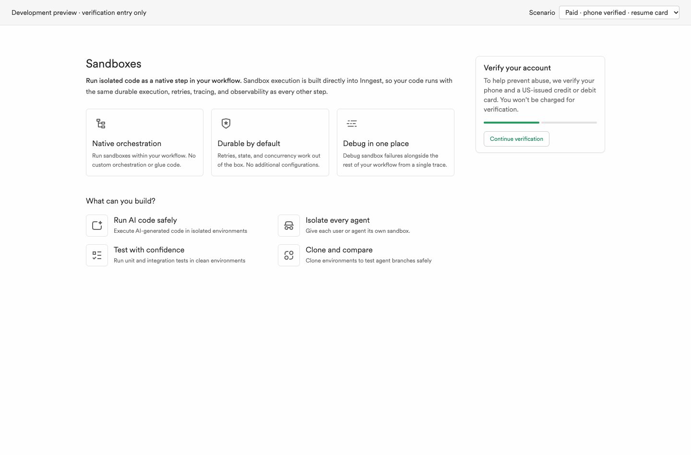
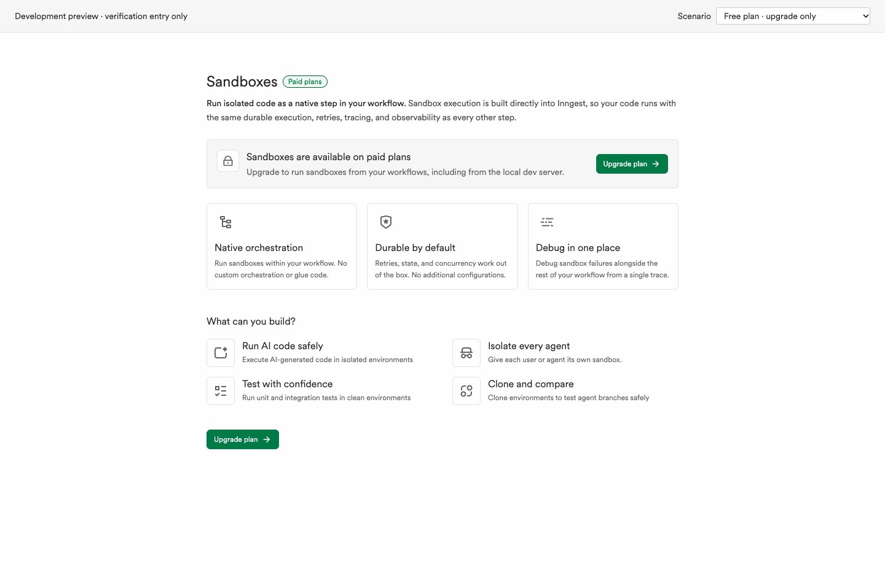

# Sandboxes verification entry frontend

Adds an optional verification callout to the existing `SandboxesEmptyState`.
The production route does not supply verification props yet, so its current
content, upgrade behavior, and navigation are unchanged.

## Review locally

From `ui/apps/dashboard`, run `pnpm preview:sandbox-verification` and open
<http://127.0.0.1:5175/sandbox-verification-demo.html>.

The preview is opt-in and does not run with `pnpm dev`. Its exact analytics
alias takes precedence over the dashboard alias, so fixture views and upgrade
clicks use local no-op functions even when a Segment write key is configured.

The scenario selector covers a free-plan upgrade state and eight paid-plan states:
not started, partially complete, started with no completed checks, admin required,
loading, error, verified, and not required.
Scenarios are also directly addressable with `?scenario=resume`, for example.
Use `?scenario=free` to review the upgrade-only state.

Start/Continue open a development-only handoff preview. Simulate completion to
return to the same zero state with the callout removed, or return without
completing to retain progress. Retry switches the error fixture to a loaded
state. These are local fixtures; they do not send SMS, collect card information,
change entitlements, or call verification APIs. The actual verification screens
remain in PR #5296 and are not duplicated here.

## Integration boundary

The host supplies `hasPaidPlan` separately from
`verification={{ state, onVerify, onRetry }}`. The default `hasPaidPlan={false}`
preserves the existing upgrade zero state. Free plans never display verification,
including loading/error/member treatments, even if verification props are supplied.

Paid plans hide the upgrade panel, upgrade buttons, and paid-plan badge. When
verification is required, show the callout; `verified` and `not-required` both
hide it without reserving a sidebar or rendering a success message. Existing
introductory content, features, and use cases are preserved in every state.

`onVerify` is the handoff point for Start and Continue. The host must carry the
current account/environment and dashboard return path into the agreed route;
the verification flow owns resuming the first incomplete check. The host also
owns status loading, retries, invalidation after returning, and clearing stale
state on account changes. No production route or URL contract is invented here.

Progress is supplied as completed/total checks. Demo fixtures use the existing
phone/card checks; the component does not assume the design's three segments
or hardcode 50%. The final check count remains a product/integration decision.
The admin-required card never exposes progress or a verification action.

Backend status/permission queries, persistence, SMS/Stripe, and access enforcement
are outside this PR. Do not infer verification requirements from
`sandboxes.enabled`: false can represent an existing plan restriction.

## Validation

Focused tests cover CTA handoff, partial and restarted progress, member-only
treatment, loading/retry, completion/removal, and preservation of the existing
zero state. Plan-precedence tests ensure free accounts only see upgrades, paid
accounts never see upgrade prompts, and switching to a free account removes
stale verification actions. The isolated preview is served only by its dedicated development
Vite configuration, which rejects production builds.

Run the checks from `ui/apps/dashboard` with:

```sh
pnpm test src/components/Sandboxes/SandboxesVerificationCallout.test.tsx vite.sandbox-verification.config.test.ts
pnpm type-check
```

Browser review also covered all nine fixtures, Start/Continue handoff, returning
without completing, simulated completion, keyboard activation, and widths of
320, 375, 768, 1024, and 1440px without horizontal overflow.

## Screenshots





